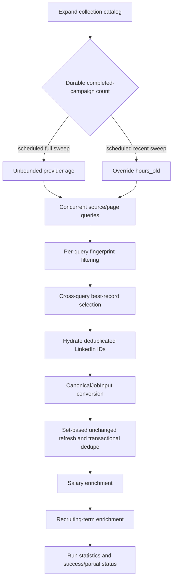

# Job Ingestion Module

## Purpose

The ingestion module turns source-specific JobSpy results into stable internal records, stores the raw source material, and coordinates multi-source collection. Its public boundary is `NormalizedJob`; downstream business code never depends directly on a JobSpy DataFrame.

## Components

| Component | File | Responsibility |
|---|---|---|
| Query contract | `src/wecanfindintern/ingestion/jobspy_adapter.py` | Validates the arguments passed to JobSpy |
| JobSpy boundary | `src/wecanfindintern/ingestion/jobspy_adapter.py` | Calls vendored JobSpy and normalizes rows |
| Query location | `src/wecanfindintern/ingestion/location_query.py` | Applies source-specific location/country query values |
| Collection catalog | `src/wecanfindintern/ingestion/collection_catalog.py` | Expands JSON plans into executable definitions |
| Detail cache | `src/wecanfindintern/db/repositories/collection_cache.py` | Reads durable campaign counts and reusable LinkedIn detail payloads |
| Campaign runner | `scripts/collection/run_collection_campaign.py` | Runs every query, retries failures, then persists and enriches |

The vendored Indeed and LinkedIn implementation is in `vendor/JobSpy`. The project pins
and audits the local source rather than importing an unconstrained package at
runtime.

## Input contract

`JobSpyQuery` contains the source list, search term, location, distance, remote/job-type/easy-apply filters, result count, Indeed country, proxies, certificate path, description format, LinkedIn description flag, offset, age filter, annual salary flag, verbosity, and user agent.

The source restrictions enforced by JobSpy remain relevant at the caller boundary. In particular, Indeed does not allow `hours_old`, `job_type + is_remote`, and `easy_apply` to be combined as arbitrary independent filters; LinkedIn does not allow `hours_old` and `easy_apply` together. The campaign uses `source_overrides` when a source requires a different query shape.

## Processing a query

`scrape_and_normalize()` performs the following steps:

1. Calls JobSpy `scrape_jobs()` with the validated query.
2. Copies the DataFrame and applies `stabilize_jobspy_frame()`.
3. Adds missing columns from the project’s documented JobSpy column set, including for a zero-row response.
4. Restricts the DataFrame to that stable column order.
5. Converts rows to JSON-safe dictionaries.
6. Converts each row into `NormalizedJob`.

JobSpy returns a pandas DataFrame. A no-result response can have zero rows and zero columns; stabilization converts it into zero rows with the full stable column contract. Flattened source fields such as `job_type`, `emails`, and source skill lists remain source-bound strings until the project normalizer splits and cleans them.

`NormalizedJob` preserves both normalized values and `raw`. The normalized fields include source fingerprint, source job id, source/direct URLs, title, company, location text, posted date, employment types, remote flag, job function, description, source contact emails, salary, company details, source skills, vacancy count, and work-from-home type.

The raw row is retained for diagnostics and reprocessing. It is not the public API payload.

## Logged source failures

Some JobSpy scrapers log an HTTP or parsing error and return an empty DataFrame instead of raising. `scrape_checked()` attaches a temporary handler to JobSpy loggers:

- empty result with no captured source error: successful empty page;
- empty result with captured source error: raises a retryable `RuntimeError` containing the latest source messages;
- non-empty result: returns the normal frame/result pair.

The handler only captures errors for the query's own sources, so a concurrent
LinkedIn failure cannot turn a genuinely empty Indeed result into a failure.
It is always removed in a `finally` block so repeated collection does not
accumulate logging handlers.

## Campaign lifecycle

`run_collection_campaign.py` separates provider collection from database
mutation and records the selected sweep mode in each ingestion run:

The default catalog covers CA and US, the configured software/data/AI internship
and co-op keyword groups, and the enabled Indeed and LinkedIn sources. Sweep
scheduling is durable in `ingestion_runs`: the first campaign is full, campaigns
2-10 request only postings from the previous 48 hours, and campaign 11 is full
again. `recent_hours` and `full_sweep_every` are configurable; process restarts
do not reset the sequence.

Each enabled catalog definition is executed once per source. A query is paged until the configured maximum result count is reached, JobSpy returns no jobs, no new fingerprints are found, or the query reaches terminal retry failure.

Within one query, `seen_for_query` prevents repeated pages from re-adding a source record. Across concurrent queries, records are keyed by fingerprint; if the same fingerprint appears more than once, the copy with salary data and then the longer description wins.

LinkedIn keyword queries collect list cards without descriptions. After
cross-query fingerprint deduplication, the campaign loads the latest stored
detail payload by source fingerprint. Reuse requires all of the following:

- `details_fetched_at` falls inside `WCFI_LINKEDIN_DETAIL_TTL_SECONDS`;
- the current card's title, company, and location agree with corresponding
  nonempty cached fields;
- the cached payload contains a description.

Each missing or stale LinkedIn source ID is fetched once with a dedicated
semaphore controlled by `WCFI_LINKEDIN_DETAIL_CONCURRENCY`. Current list-card
metadata remains authoritative while detail-only fields are overlaid. A failed
fresh fetch uses the stored stale detail payload when available. The campaign
records `linkedin_detail_cache_hits`, `linkedin_detail_fetched`,
`linkedin_detail_failed`, and `linkedin_detail_stale_fallbacks`. A list-card
observation never advances detail freshness.

## Retry, isolation, and scope filtering

The campaign uses an asyncio semaphore, default concurrency 4, and runs blocking
JobSpy calls in worker threads. Transient failures are retried up to the
configured maximum with exponential backoff and random jitter, capped at 15
seconds. Deterministic provider failures such as unsupported locations or
non-retryable HTTP 4xx responses open a per-run source circuit so remaining
queries for that source are skipped. One source failure does not cancel unrelated
sources.

LinkedIn search and detail HTTP requests share a process-wide controller in
`vendor/JobSpy/jobspy/linkedin/request.py`, which spaces request starts and allows up to two in flight:

- **AIMD:** starts at 0.2 requests/second. Each successful response adds 0.02
  requests/second, up to one request per second. Each HTTP 429 halves the
  rate, with a lower bound of one request every 60 seconds. During recovery only one request may be in flight.
- **Exponential backoff:** consecutive HTTP 429 responses wait 60, then 120
  seconds, plus 0–10 seconds of jitter. Both numeric and HTTP-date `Retry-After`
  headers are honored when they require a longer wait. The requests adapter and
  campaign do not multiply these 429 retries.
- **Circuit breaker:** the third consecutive HTTP 429 opens the controller's
  circuit for at least 300 seconds, or longer if `Retry-After` requires it.
  Calls during this window fail without HTTP traffic. The next call after the
  cooldown is a single half-open probe: success closes the circuit; a failed
  probe reopens it.

LinkedIn keyword queries are serialized outside the campaign's global semaphore,
so queued LinkedIn work cannot occupy all slots while Indeed is collecting.
When the controller opens its circuit, the campaign skips remaining LinkedIn
queries for that run. Detail hydration pauses further fetches and uses stale
cached descriptions where available. Other sources continue and the existing
partial-result publication policy still applies. Controller state is local to
the Python process; successful-query checkpoints remain durable separately.

When the request has `country_indeed=Canada` or `USA`/`United States`, the returned location is parsed and records outside the requested country are discarded before persistence. If no country scope is supplied, the adapter does not apply this filter.

The cloud runner calls the campaign implementation directly. GitHub Actions concurrency and a PostgreSQL advisory lock prevent overlapping cloud campaigns. Public scraping is not scheduled or executed by the desktop app.

### Concurrency and restart semantics

The semaphore limits query tasks, not the number of API workers or database
connections. Blocking JobSpy work runs in threads so the event loop can schedule
other queries. The database phase begins only after all network tasks finish;
therefore a slow source cannot interleave half-collected source data with an
already-running dedupe batch.

Page offsets and `seen_for_query` are process-local. The campaign deliberately
does not persist a per-page checkpoint. If the process stops, rerun the full
campaign: already committed batches are safe because source fingerprints and
database unique constraints make them unchanged/idempotent, while changed raw
payloads are recorded by hash. This is a restart-from-source strategy, not a
claim of resumable page-level crawling.

The cloud runner checkpoints completed queries in PostgreSQL. A retry reuses
eligible checkpoints; unfinished queries restart from their first page. Desktop
shutdown interrupts only feed synchronization, which resumes from its committed
local cursor.

## Persistence handoff

The campaign creates one ingestion run after provider collection, converts every
`NormalizedJob` into `CanonicalJobInput`, and writes in batches. Valid structured
source salary is part of that canonical input. All source records are therefore
available to deduplication before description-based enrichment, and the same
description hash gates later deterministic/model enrichment.

At the start of each ingest transaction, the repository hashes the incoming
payloads and refreshes unchanged source rows in one SQL statement. Matching
payload hashes update `last_seen_at`, `last_scraped_at`, job visibility, and any
newer LinkedIn detail timestamp; they skip candidate lookup and raw snapshot
insertion. New or changed rows continue through source-fingerprint and dedupe-
block advisory locks, and a new raw snapshot is written only for a changed hash.

The `Public job feed` workflow is the operational entry point for collection and publication. The desktop consumes the published feed; it does not run JobSpy.

## Failure behavior

- Empty successful query: contributes no jobs and does not fail the campaign.
- Source error: retries, then records the source/query failure and continues.
- Invalid source payload: row-level normalization converts missing values to `None`/empty lists where the model permits; malformed values do not enter public records.
- Unknown country/location: the original location text is preserved; canonical structured fields remain unset rather than guessed.
- Database failure: the persistence stage fails the run; collection results are not silently reported as fully ingested.
- Unresolved regex enrichment: salary and recruiting term remain absent; an
  unchanged content hash is cached as `not_found`. Conditional writes do not
  overwrite a concurrently changed JD.

The campaign is `partial` when one or more source queries exhaust retries but the
database pipeline completes. A database or pipeline exception is fatal to the
current command, but committed earlier batches remain valid and the next run can
reconcile them. After deduplication, provider-structured salary wins; missing
salary and recruiting terms are normalized directly by deterministic regex.
There are no LLM requests, model retries, or deferred model batches.
A successful salary extraction is `complete`, and a definitive miss is
`not_found`. Both are skipped until the description hash changes.

## Operator scenarios

| Observed outcome | Persisted result | Supported action |
|---|---|---|
| Query returns zero rows without source errors | successful empty query | continue; the campaign can still finish `success` |
| Query logs/raises a source error | bounded retries, then a recorded source failure | inspect the source failure and rerun the campaign after the source recovers |
| One query exhausts retries | successful query results continue to persistence; run finishes `partial` | retain committed data and rerun the full catalog |
| Process stops during network collection | no database phase for the in-memory records | restart the full campaign from the catalog |
| Process stops during batch persistence | committed batches remain; active transaction rolls back | restart the full campaign; identity constraints reconcile records |
| Fresh LinkedIn detail request fails | stale stored detail is used when present; card fields otherwise remain | rerun after LinkedIn recovers; detail freshness advances only after a successful fetch |
| Enrichment provider fails | canonical jobs and completed enrichment remain | fix provider configuration and rerun/backfill the affected enrichment |
| Process lock is already held | second invocation exits without collection | inspect the active Actions run and wait for it |

## Verification surface

- `src/wecanfindintern/ingestion/tests/test_jobspy_adapter.py`: stable columns, conversion, query validation.
- `src/wecanfindintern/ingestion/tests/test_scrape_checked.py`: empty success versus logged source failure.
- `src/wecanfindintern/ingestion/tests/test_linkedin_requests.py`: country display,
  real card normalization, shared AIMD pacing, Retry-After/backoff, and circuit probes.
- `src/wecanfindintern/ingestion/tests/test_collection_catalog.py`: catalog expansion and source overrides.
- `scripts/collection/tests/test_collection_campaign.py`: sweep cadence, LinkedIn cache/hydration,
  retry isolation, and campaign status.
- `src/wecanfindintern/db/tests/test_job_ingestion_repository.py`: persistence and identity behavior.
- `src/wecanfindintern/ingestion/tests/test_salary_enrichment.py`: signal gating, content-hash state, and
  structured/regex/model precedence.

## Safe extension procedure

When adding or upgrading a source:

1. Compare the vendored JobSpy model and desired column order.
2. Update the adapter’s stable columns and row mapping.
3. Add source-specific query overrides only in the catalog/config boundary.
4. Test zero-result, partial-field, salary, URL, date, and logged-error responses.
5. Inspect source/query outcomes in the cloud workflow logs.
6. Confirm raw output, canonical output, database ingest, and API response remain separate contracts.
